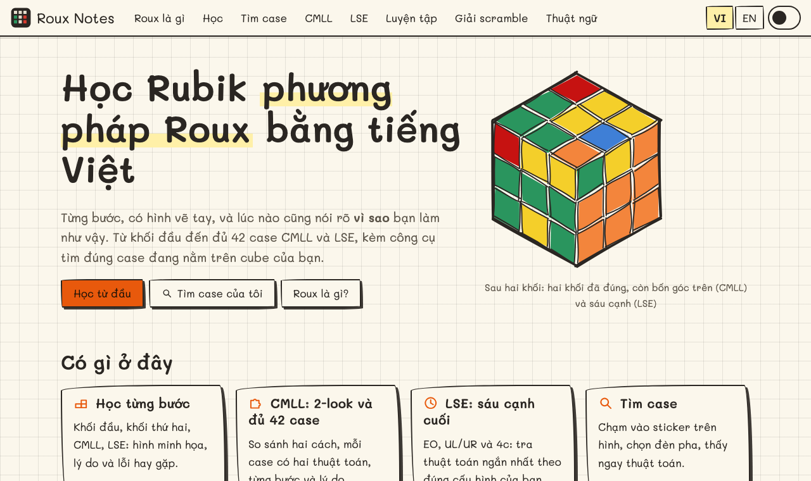
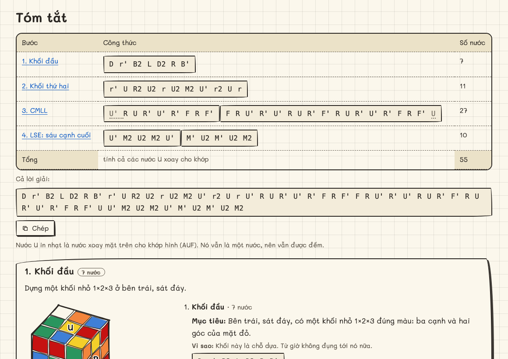

# Roux Notes

**Học Rubik phương pháp Roux bằng tiếng Việt.** Từng bước có hình vẽ tay, luôn nói rõ *vì sao* làm như vậy, kèm công cụ tìm case CMLL, bài luyện scramble và trình giải scramble theo Roux.

A hand-drawn guide to the Roux method for the 3×3 Rubik's Cube, written first in Vietnamese with a full English mode.

**Live site:** https://hong4rc.github.io/roux-notes/

[](https://github.com/hong4rc/roux-notes/actions/workflows/deploy.yml)
[](LICENSE)



## What is inside

- **Learn step by step:** first block, second block, CMLL and LSE (last six edges), each with pictures drawn from a cube simulation, the reason behind every move, and common mistakes.
- **CMLL:** the 2-look approach (few algorithms) and all 42 cases, with community algorithms ranked by votes, finger-trick notes and a practice scramble for every case.
- **Case finder:** tap the stickers you see on your cube and get the matching CMLL case and the U turn to do first.
- **LSE:** learn by idea (a handful of short sequences you understand rather than memorise), lookup tables for EO, UL/UR and 4c, and advanced topics such as EOLR.
- **Practice:** random-state scrambles for the full solve or for a single step.
- **Scramble solver:** paste a scramble and see a Roux solution step by step, with a move player.
- **Glossary and notation:** R U R', M, AUF, EO and finger tricks.
- Light and chalkboard (dark) themes, Vietnamese and English, works on phones.



## Getting started

Requires [Bun](https://bun.sh) 1.1 or newer.

```sh
bun install
bun run dev       # http://localhost:5273, also reachable from the local network
```

| Command | What it does |
| --- | --- |
| `bun run dev` | Start the development server on port 5273. |
| `bun run verify` | Check every algorithm, solver and drill against the cube simulator. |
| `bun run build` | Type-check, then build the static site into `dist/`. |
| `bun run preview` | Serve the built site on port 5273. |
| `bun run scripts/check-i18n.ts` | Open every page in English mode and fail on any Vietnamese text left. Needs a local Playwright Chromium. |

## How correctness is checked

The pictures and algorithms are not copied by hand. A small cube engine in `shared/cube.ts` simulates every move, and `bun run verify` checks, among other things, that:

- every CMLL algorithm keeps both blocks and the centres intact and solves the four top corners of its case, and the cases cover all 648 corner states;
- every LSE sequence and table entry does what the page says; the LSE tables come from an exhaustive search of all 184,320 LSE states;
- the scramble solver returns a correct solution for a set of random scrambles.

The same checks run in continuous integration on every push and pull request.

## Project layout

```text
src/
  pages/        one file per route (home, learn, cmll, lse, finder, practice, solve, glossary, about)
  components/   cube drawings, move player, layout, shared UI
  data/         algorithms and generated lookup data
  lib/          routing, settings store, translations, scramble and solver glue
shared/         cube engine, block solver and LSE search, shared by the site and the scripts
scripts/        verification, data builders and screenshot helpers
public/         logo and static files
```

## Deployment

Every push to `main` runs `.github/workflows/deploy.yml`: install with Bun, run `bun run verify`, build, and publish `dist/` to GitHub Pages. Pull requests run the checks without deploying. The site uses hash routes and a relative base path, so it works from any sub-path.

## Sources and credits

- CMLL algorithms: [Ruwix](https://ruwix.com/) (Kian Mansour's list), Scheopner, and community votes from [SpeedCubeDB](https://speedcubedb.com/).
- LSE and EO material: [Rouxvolution](https://rouxvolution.pages.dev/) and [CubeTools](https://bradleykh.github.io/CubeTools/).
- Finger tricks: Ruwix, ZeroPlay and Cubelelo; moves without a published source are marked as player habit on the site.
- Scrambles: [cubing.js](https://js.cubing.net/cubing/).
- Font: [Mali](https://fonts.google.com/specimen/Mali) by Cadson Demak (SIL Open Font License), via Fontsource. Sketch style: [Rough.js](https://roughjs.com/).

## License

The code is released under the [MIT License](LICENSE). Algorithms and material from the sources above remain credited to their authors.
